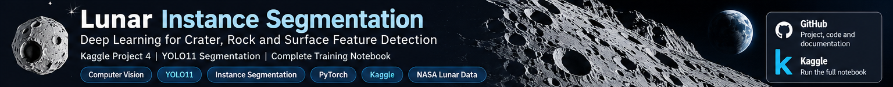
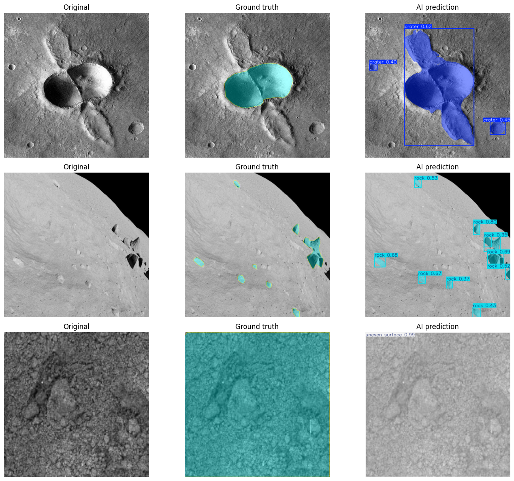

<h1 align="center">🌙 Lunar Terrain Instance Segmentation</h1>

<strong>Project 04 · Deep Learning · YOLO11n-seg · PyTorch · Kaggle</strong>

> **Research question:** Can a lightweight pretrained YOLO segmentation model locate and outline craters, rocks, uneven terrain and lunar artifacts? Does increasing input resolution from 320 to 512 improve segmentation when both models are trained for 20 epochs?

## 📌 Key findings

- **Selected model:** YOLO11n-seg, **512 × 512**, trained for **20 epochs** with pretrained weights.
- **Independent held-out test:** Mask **mAP50 = 0.603**, Mask **mAP50–95 = 0.409**, precision **0.686**, recall **0.580** on **173 filtered test images**, 1,038 labelled instances.
- **Validation comparison:** 512-pixel inputs improved Mask mAP50 from **0.561 to 0.591** (+0.030) and Mask mAP50–95 from **0.389 to 0.415** (+0.026) relative to 320-pixel inputs, under the tested settings.
- **Dataset caveat:** **35 image/annotation pairs were excluded** because a class ID of 4 appeared although the supplied configuration defines only classes 0–3. There were 32 in train, 2 in validation and 1 in test. The dataset's missing fifth-class meaning was **not inferred or relabelled**.

## 📊 Results

### Original learning baseline (5 epochs)
The initial YOLO11n-seg baseline used 320-pixel images. It yielded **validation** Mask mAP50 **0.537**, precision **0.586**, and recall **0.544**. It was trained before the explicit dataset audit and filtering in the full notebook, so treat comparisons to the 20-epoch experiments as **indicative, not perfectly controlled**.

### Controlled training comparison (20 epochs each)

| Validation metric | 320 × 320 | 512 × 512 |
|---|---:|---:|
| Box mAP50 | 0.598 | **0.609** |
| Mask mAP50 | 0.561 | **0.591** |
| Mask mAP50–95 | 0.389 | **0.415** |
| Mask precision | 0.652 | **0.659** |
| Mask recall | 0.555 | **0.581** |

The experiment used the same filtered data, model family, pretrained starting point, seed and 20-epoch budget; input size varied. **One run per setting is not enough to establish statistical significance** or general superiority of the higher resolution.

### Final held-out test — selected 512-pixel model

| Test metric | Score |
|---|---:|
| Box mAP50 | 0.614 |
| Mask mAP50 | **0.603** |
| Mask mAP50–95 | 0.409 |
| Mask precision | 0.686 |
| Mask recall | 0.580 |

**Per-class test Mask mAP50:** crater **0.456** · rock **0.469** · uneven surface **0.898** · lunar artifacts **0.590**. Crater and rock segmentation remain the more difficult categories in this experiment.

> **Metric note:** Mask mAP50 is *not* pixel accuracy. It summarises object-level mask average precision across confidence thresholds using mask intersection-over-union (IoU) ≥ 0.5 for matching. Precision and recall describe a precision/recall operating point from the evaluation library, not universal guarantees of correct predictions.

## 🖼️ What predictions look like

*Figure from the executed Kaggle notebook. Qualitative examples help identify missed objects and imperfect mask boundaries; numerical metrics above are computed over the corresponding evaluation splits.*

## 🧠 Concepts to remember

| Concept | Explanation |
|---|---|
| Neural network | A computational model whose weights are learned from data |
| CNN | Learns spatial visual features through convolutional operations |
| Instance segmentation | Identifies **each** object and predicts its individual pixel mask |
| Transfer learning | Adapts model weights pretrained on another dataset |
| Epoch | One pass through the training dataset |
| Loss | Training objective that guides weight updates |
| Precision | Correct predicted objects / predicted objects at an operating point |
| Recall | Detected labelled objects / labelled objects at an operating point |
| IoU | Predicted/true mask overlap area divided by union area |
| mAP50–95 | Mean AP averaged over multiple IoU thresholds from 0.50 through 0.95 |
| Overfitting | Learning dataset-specific patterns that do not generalise |

**From image to prediction:** pixels → CNN feature maps → class and bounding-box predictions → per-object segmentation masks. Training compares these outputs to annotated targets and uses backpropagation to update weights.

## 🔬 Notebook workflow

1. Inspect dataset YAML and audit segmentation polygon annotations.
2. Exclude samples containing invalid class IDs, leaving **1,345 train / 287 validation / 173 test images**.
3. Plot images and ground-truth annotations.
4. Fine-tune **YOLO11n-seg** for 20 epochs at **320 px** and **512 px**.
5. Evaluate on validation data; choose a model using **Mask mAP50–95**.
6. Compare predicted masks with ground truth.
7. Evaluate the selected model on the test set **once**, then export metrics and model weights.

## 🚀 Reproduce on Kaggle

1. Attach the [Moon Instance Segmentation Kaggle dataset](https://www.kaggle.com/datasets/umaimak/moon-instance-segmentation) and enable a GPU and Internet access as needed for dependencies and pretrained weights.
2. Import [`notebooks/04_Lunar_Instance_Segmentation.ipynb`](notebooks/04_Lunar_Instance_Segmentation.ipynb).
3. Run the cells in sequence. Paths are tailored to Kaggle's `/kaggle/input` and `/kaggle/working` directories.
4. Save a Kaggle version to retain the generated checkpoint and CSV summaries. Outputs committed in this repository originate from a completed run; running again can produce somewhat different results depending on the environment.

**Dataset provenance:** [Roboflow Lunar Terrain Segmentation v3](https://universe.roboflow.com/aerolite/lunar-terrain-segmentation/dataset/3). The included dataset YAML reports **CC BY 4.0**. Images and labels are not redistributed here.

## ⚠️ Limitations and responsible interpretation

- **Label inconsistency:** 35 excluded samples contained class ID 4, whose semantics were not defined in the four-class YAML. Exclusion changes the evaluated data distribution.
- **Class imbalance:** per-class performance is uneven, particularly for crater and rock categories.
- **Possible data overlap:** provenance and near-duplicate scene separation across splits were not independently verified.
- **Limited experimental budget:** one seed and 20 epochs per resolution; no confidence intervals or cross-validation.
- **Not deployment-ready:** benchmark results do not establish safety or robustness for autonomous lunar navigation.

## 🌞 Next project

Solar filament segmentation: inspect the new dataset labels and competition metric before deciding whether to use instance- or semantic-segmentation architectures.

---

*The top banner is an AI-generated decorative graphic, not an experimental result. The prediction comparison is an actual figure from the executed notebook.*
